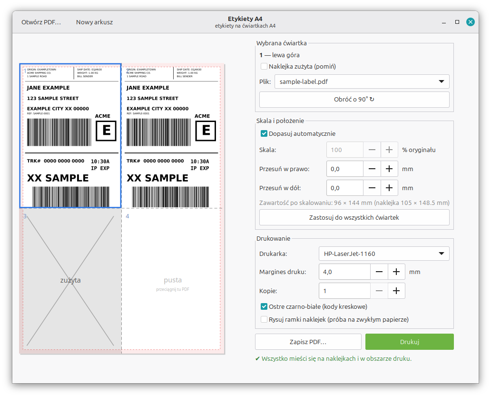

# A4 Label Sheets (Etykiety A4)

Print shipping labels (e.g. 4×6" from FedEx, DPD, UPS…) onto **A4 sticker sheets with 4 labels per page**
using an ordinary laser/inkjet printer. Load PDF labels, see a live preview, fix scale if something doesn't fit, print.

*PL: drukuj etykiety wysyłkowe 4×6" na arkuszach A4 z czterema naklejkami (ćwiartki A4) zwykłą drukarką.
Wczytujesz PDF-y, widzisz podgląd, w razie potrzeby poprawiasz skalę i drukujesz. Interfejs programu jest po polsku.*



(The screenshot uses a fictional label from [`examples/`](examples/).)

## Features

- Load several PDFs at once (file dialog, drag & drop, or command-line arguments); every PDF page is one label
- A4 preview split into four quarters (105 × 148.5 mm), with the printer's non-printable margin shown
- **Auto-fit**: measures the real content of the label and scales it to fit the sticker and the printable area
- Manual scale (% of original), X/Y offset in mm, 90° rotation — per quarter
- Red warning when a label sticks out of the sticker or the printable area, *before* you waste a sticker
- Remembers which stickers on the sheet are already used (**"Nowy arkusz"** = new sheet)
- Test mode: prints the sticker outlines on plain paper so you can check alignment against the real sheet
- Renders at 600 dpi; optional sharp black & white output so barcodes stay crisp
- Save the composed A4 sheet as PDF instead of printing

## Install

Needs Python 3, GTK 3 with Python bindings, pycairo, Pillow, poppler-utils and a CUPS client (`lp`, `lpstat`).

```bash
# Debian / Ubuntu / Linux Mint (tested on Linux Mint 22)
sudo apt install python3-gi gir1.2-gtk-3.0 python3-cairo python3-pil poppler-utils cups-client

# Fedora (package names not tested)
sudo dnf install python3-gobject gtk3 python3-cairo python3-pillow poppler-utils cups-client

# Arch (package names not tested)
sudo pacman -S python-gobject gtk3 python-cairo python-pillow poppler cups
```

Run it:

```bash
python3 a4_label_sheets.py [label.pdf ...]
./install.sh            # optional: adds an "Etykiety A4" launcher to your application menu
./install.sh --uninstall
```

## Printing — please read

1. **Always do a test print on plain paper first**: tick *"Rysuj ramki naklejek"* (draw sticker outlines),
   print, and hold the page against the sticker sheet in front of a light. Adjust margin / offset if needed.
   Test prints do not mark stickers as used.
2. The app sends the sheet with `lp -o media=A4 -o print-scaling=none -o fit-to-page=false -o StpiShrinkOutput=Crop`.
   The last option only matters for Gutenprint drivers and is ignored by others. If your driver rescales the page,
   tweak `send_to_printer()` in the source.
3. Printers differ in their non-printable margin — change **Margines druku** (default 4 mm) to match yours.

## Status / limitations

- Tested on **Linux Mint 22 (X11)** with an HP LaserJet 1160 (Gutenprint driver). Other distros, Wayland and
  other printers should work in principle (GTK 3 + CUPS) but are untested.
- The user interface is Polish only.
- Output is a 600 dpi raster (not vector) — good enough for barcodes in practice, but not for tiny fine print.
- Linux only (uses `lp`/`lpstat`/`pdftoppm`).
- Provided as is, no support promised. Pull requests are welcome.

## License

[MIT](LICENSE)

---

## PL — skrót

**Instalacja:** zainstaluj zależności (komenda `apt` powyżej), uruchom `python3 a4_label_sheets.py`.
Opcjonalnie `./install.sh` doda skrót do menu aplikacji.

**Użycie:** „Otwórz PDF…” (lub przeciągnij pliki na okno) → sprawdź podgląd → w razie potrzeby odznacz
„Dopasuj automatycznie” i ustaw skalę/przesunięcie → „Drukuj”. Po wydruku ćwiartki są oznaczane jako zużyte;
po włożeniu nowego arkusza kliknij „Nowy arkusz”.

**Uwaga:** pierwszy wydruk zrób na zwykłym papierze z zaznaczonymi „Rysuj ramki naklejek” i sprawdź
dopasowanie do arkusza z naklejkami pod światło.
